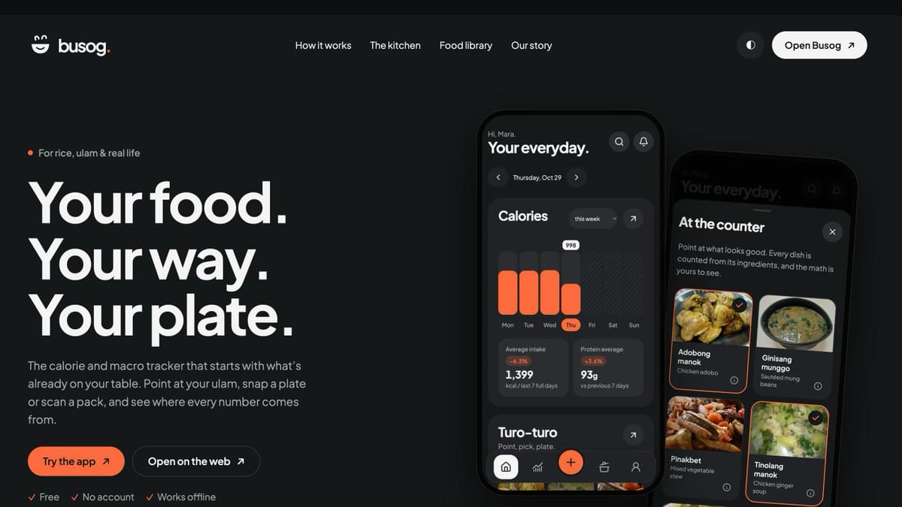
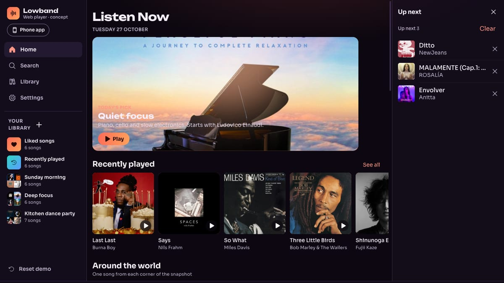

By day I'm moving a large online-lesson platform from CakePHP to Laravel, one endpoint at a time, and proving each one
answers exactly like the old code before it ships. After hours I build the things I want to use myself: a calorie tracker
that knows Filipino food, a music player that pulls my libraries into one place, and scrapers for anime I watch.

### Recent work

<!-- WORK:START -->
<table>
<tr>
<td width="50%" valign="top">

<h3><a href="https://github.com/vanomarb/busog">Busog</a></h3>
<code>Svelte</code> <code>Astro</code> <code>TypeScript</code> · updated Oct 29 · <a href="https://vanomarb.github.io/busog/">Try it ↗</a>

A Filipino-first calorie tracker: point at your ulam, snap a plate, or search USDA food.

</td>
<td width="50%" valign="top">

<h3><a href="https://github.com/vanomarb/lowband">Lowband</a></h3>
<code>TypeScript</code> <code>CSS</code> <code>JavaScript</code> · updated Oct 28 · <a href="https://vanomarb.github.io/lowband/">Try it ↗</a>

One library for music that lives on different services.

</td>
</tr>
</table>
<!-- WORK:END -->

### Tools I reach for

### This year on GitHub

Recent work, the stats card and the snake are redrawn by this repository's GitHub Actions: the snake daily, everything else every three days.
